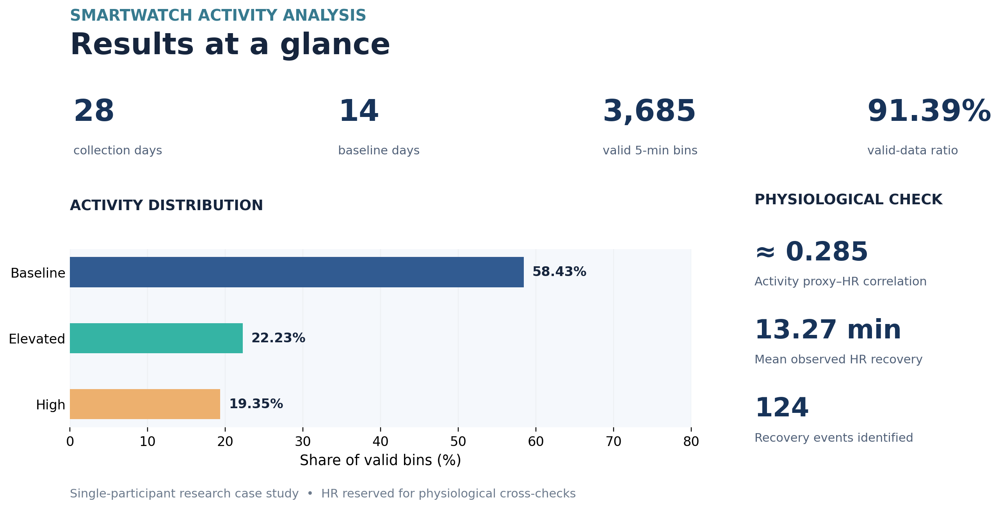
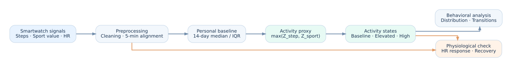
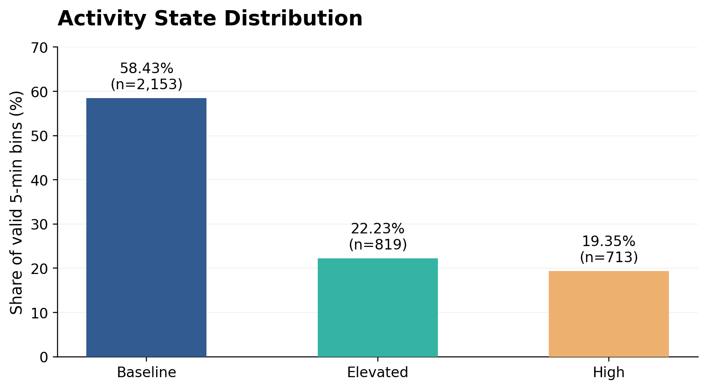
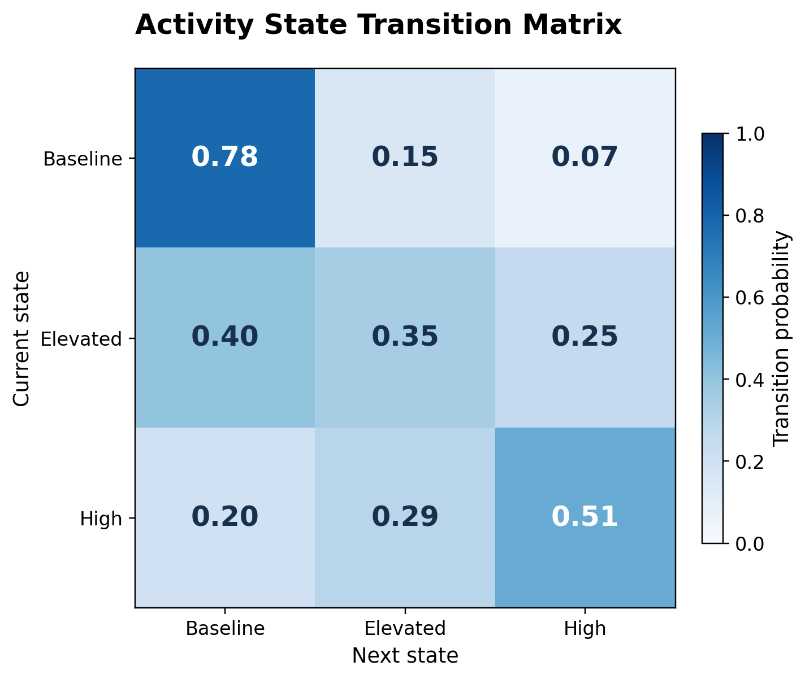
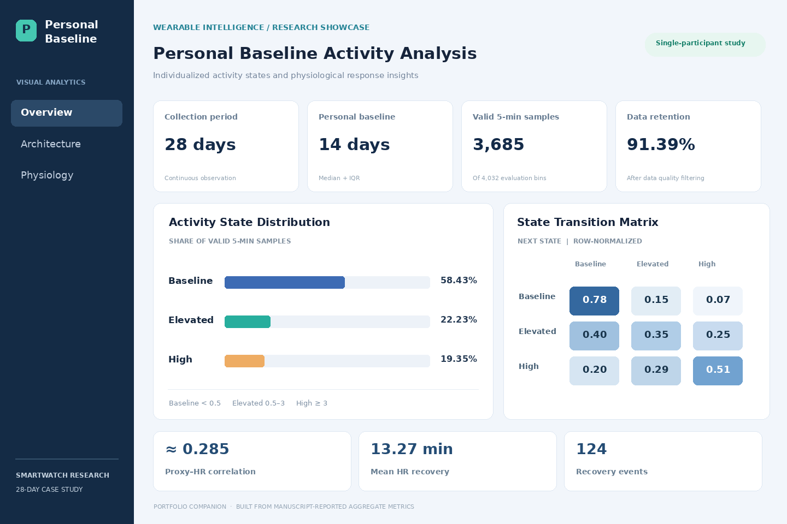

# JKIICE Paper

## 스마트워치 데이터를 활용한 개인 기준선 기반 활동 상태 분석

스마트워치의 **걸음 수·운동 지표(sport value)** 데이터를 개인 기준선에 따라 정규화하고, 활동 프록시로 상태를 분류한 뒤 **심박수(HR)를 별도의 생리적 평가 지표**로 활용하는 연구입니다.

이 저장소는 **50대 남성 작업자 1인을 대상으로 한 28일 사례 연구의 GitHub 포트폴리오 자료**입니다. 논문에 보고된 분석 구조와 결과를 시각화했으며, 포트폴리오 전용 대시보드도 포함합니다.

[English README](README.md) · [결과 대시보드](dashboard/index.html) · [분석 방법](docs/METHODOLOGY.md)



## 핵심 설계



스마트워치 데이터 정제 및 5분 단위 정렬 → 초기 14일 개인 기준선 설정 → 중앙값·IQR 기반 정규화 → 활동 프록시 생성 → Baseline/Elevated/High 상태 분류 → 상태 분포·전이 분석 → 심박수 기반 생리 반응 및 회복 분석 순서로 구성됩니다.

활동 프록시는 다음과 같습니다.

`ActivityProxy(t) = max(Z_step(t), Z_sport(t))`

활동 상태 기준은 Baseline(0.5 미만), Elevated(0.5 이상 3 미만), High(3 이상)입니다. 이 값들은 개인 기준선 대비 **상대적 활동 수준**을 의미하며, 일반 인구의 절대적 운동 강도 기준이 아닙니다.

## 실험 및 정량 결과

| 지표 | 결과 |
|:--|--:|
| 데이터 수집 | 28일 |
| 초기 기준선 | 14일 |
| 평가 기간 | 14일 |
| 분석 단위 | 5분 |
| 유효 샘플 | 3,685개 / 4,032개 |
| 데이터 유효 비율 | 91.39% |
| Baseline / Elevated / High | 58.43% / 22.23% / 19.35% |
| 활동 프록시–심박수 상관계수 | 약 0.285 |
| 심박 회복 이벤트 | 124건 |
| 평균 / 중앙값 회복 시간 | 13.27분 / 5분 |





심박수는 활동 분류의 입력으로 사용하지 않고 **분류 후의 독립적인 생리 반응 확인**에 사용했습니다. 이 연구는 정답 레이블을 활용한 활동 인식 정확도 시험이 아닌, 단일 사용자의 장기간 활동·심박 패턴을 분석한 사례 연구입니다.

## 시각화 결과 화면



저장소를 다운로드하거나 복제한 뒤 `dashboard/index.html`을 브라우저에서 열면 활동 상태 분포, 전이 확률, 분석 아키텍처, 심박 반응 결과를 볼 수 있습니다. 이 웹 화면은 **논문에 보고된 집계 수치로 새로 제작한 포트폴리오용 결과 뷰어**이며, 실제 서비스 구축 성능을 주장하지 않습니다.

## 폴더 구성과 사용법

- `README.md`: 영어 프로젝트 소개
- `assets/`: 분석 구조 및 결과 시각화
- `dashboard/index.html`: 결과 대시보드
- `docs/METHODOLOGY.md`: 분석 방법 정리
- `scripts/plot_paper_metrics.py`: 집계 결과 차트 재생성 스크립트

```bash
python -m pip install numpy matplotlib
python scripts/plot_paper_metrics.py
```

**적용 가능성:** 개인의 평소 활동 대비 변화 추적, 활동 수준과 심박 반응의 관계 분석, 장기 생활 패턴 분석 등을 위한 기초 연구로 활용될 수 있습니다. 다수 사용자에 대한 일반화와 임상적 진단 성능은 본 사례 연구에서 검증한 항목이 아닙니다.
