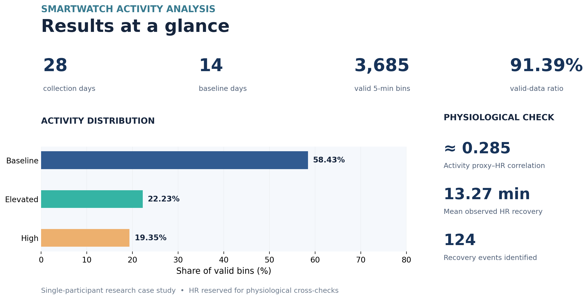
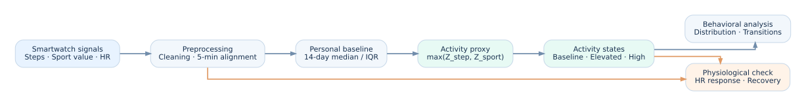
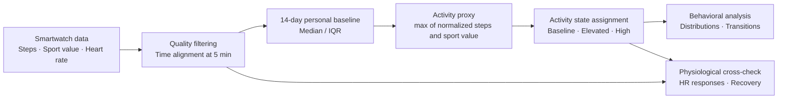
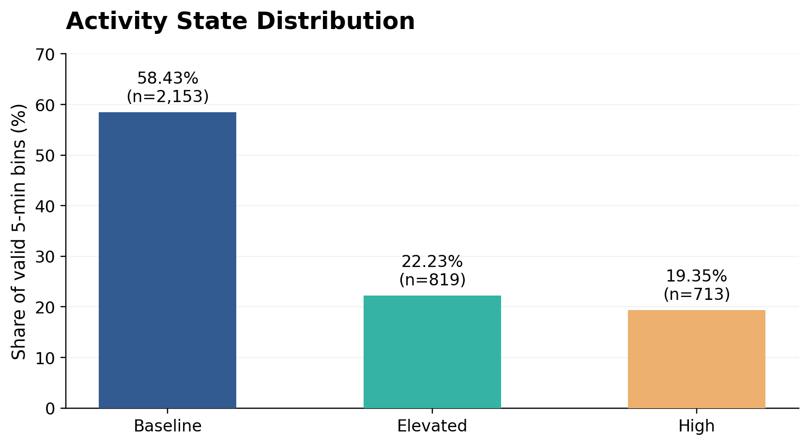
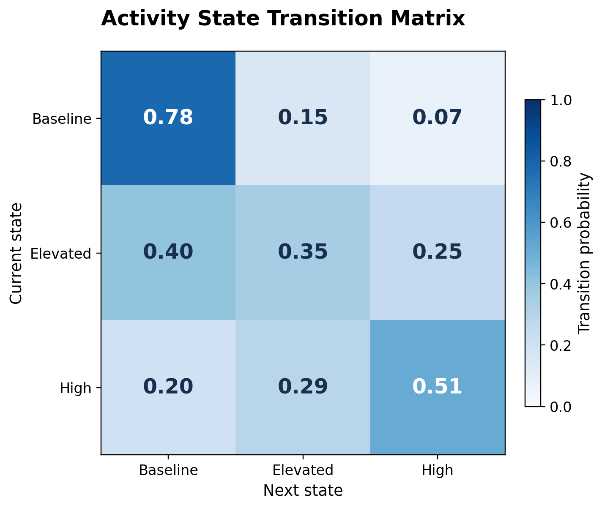
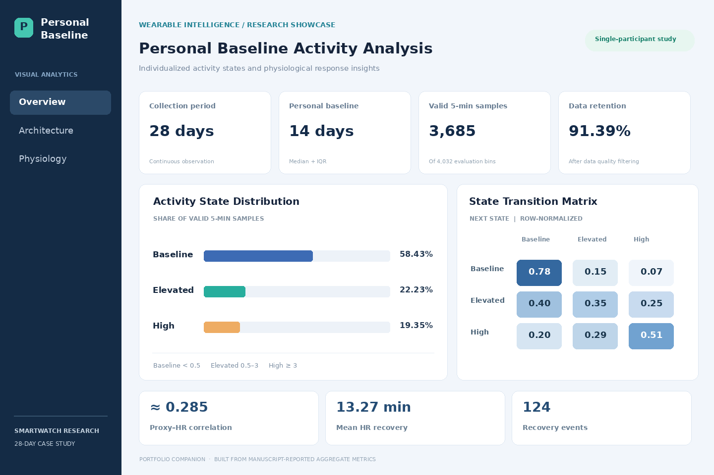

# JKIICE Paper

## Personal Baseline–Driven Activity State Analysis Using Smartwatch Data

**A smartwatch-based research framework for interpreting personal activity patterns and physiological responses over time.**

This repository is a **research portfolio showcase** of a 28-day, single-participant case study. It presents a personal-baseline normalization strategy, a two-signal activity proxy, three interpretable activity states, state-transition analysis, and a separate heart-rate-based physiological assessment.

**[한국어 소개](README.ko.md) · [Interactive Results Dashboard](dashboard/index.html) · [Research Methods](docs/METHODOLOGY.md)**



## At a glance

| Research dimension | Approach |
|:--|:--|
| **Problem** | Understanding individual activity fluctuations without requiring labeled activity classes |
| **Observations** | Step count, proprietary smartwatch sport-value indicator, and optical heart rate |
| **Personalization** | 14-day reference window; robust median/IQR normalization |
| **Activity representation** | `max(Z_step, Z_sport)` per aligned time bin |
| **Interpretable states** | Baseline / Elevated / High |
| **Physiological cross-check** | HR analyzed separately from the activity-state definition |
| **Behavioral interpretation** | Activity distribution, 24-hour trends, transition probabilities, and HR recovery |

## System architecture



<details>
<summary>View the editable pipeline diagram (Mermaid)</summary>



</details>

### Why the design matters

- **Individual-relative scaling:** personal baseline statistics capture departures from a participant's normal activity profile.
- **Complementary movement signals:** step count and the device-derived sport indicator help represent different activity patterns with one transparent proxy.
- **Decoupled physiology:** HR is withheld from state assignment and used afterward to examine whether behavior-derived states correspond to meaningful physiological responses.
- **Longitudinal interpretation:** the pipeline goes beyond isolated samples to explore state persistence, changes, and post-activity recovery.

## Activity-state formulation

After cleaning and synchronization, activity-related features are normalized against the 14-day baseline:

$$
Z_x(t)=\frac{x(t)-\operatorname{median}(x_{\mathrm{baseline}})}{\operatorname{IQR}(x_{\mathrm{baseline}})}
$$

$$
\mathrm{ActivityProxy}(t)=\max\{Z_{\mathrm{step}}(t),Z_{\mathrm{sport}}(t)\}
$$

The study uses three **relative**, not universally calibrated exercise-intensity, categories:

| Activity state | Proxy interval | Interpretation |
|:--|:--|:--|
| Baseline | `< 0.5` | Rest / low activity relative to the individual's reference |
| Elevated | `0.5 ≤ proxy < 3` | Increased day-to-day activity |
| High | `≥ 3` | High activity relative to the personal baseline |

The thresholds were selected for the case-study distribution; portability to other individuals remains a subject for additional evaluation.

## Experimental design

| Item | Value |
|:--|--:|
| Observation period | **28 days** |
| Participant | **1 male worker in his 50s** |
| Baseline estimation | **First 14 days** |
| Evaluation | **Following 14 days** |
| Analysis resolution | **5 minutes / sample** |
| Expected evaluation samples | **4,032** |
| Valid evaluation samples | **3,685** |
| Valid-data ratio | **91.39%** |

Heart-rate observations were aligned to the activity stream using 5-minute averages; missing and invalid data were excluded rather than interpolated.

## Results

### 1 · Clear, interpretable activity-state patterns



| State | Count | Reported share |
|:--|--:|--:|
| Baseline | 2,153 | 58.43% |
| Elevated | 819 | 22.23% |
| High | 713 | 19.35% |

The study participant spent most recorded intervals in the lower-activity state, with intermittent periods of higher activity.

### 2 · Temporal continuity and transitions



The observed self-transition probability was **0.78** for Baseline and **0.51** for High, illustrating that activity states often persisted across adjacent 5-minute intervals.

### 3 · Independent physiological response assessment

| HR-related metric | Reported result |
|:--|:--|
| Activity proxy–HR correlation | **≈ 0.285** |
| Strongest cross-correlation | **Lag 0** at 5-minute resolution |
| HR recovery events | **124** |
| Mean observed recovery time | **13.27 min** |
| Median observed recovery time | **5 min** |

Heart-rate distributions generally increased across Baseline, Elevated, and High states. During activity-state transitions, increases in activity were accompanied by rising HR trends, while decreases showed recovery trends.

> **Interpretation:** HR association here is a *physiological consistency check*, not a ground-truth activity label, clinical assessment, or classification accuracy score.

## Interactive results dashboard

A lightweight **portfolio companion interface** turns the aggregate findings reported in the manuscript into an accessible visual summary. It includes:

- Overview KPIs and activity-state distribution
- A row-normalized state-transition matrix
- The pipeline architecture and activity-proxy definition
- Physiological response and recovery highlights



**Launch locally:** download or clone this repository, then open [`dashboard/index.html`](dashboard/index.html) in a browser. It uses HTML, CSS, and JavaScript without dependencies. The dashboard is a presentation layer created for this portfolio, not a claim that a deployed wearable monitoring product was evaluated in the study.

## Repository contents

```text
JKIICE_Paper/
├── README.md                   # English project showcase
├── README.ko.md                # Korean project showcase
├── assets/
│   ├── architecture.svg        # Editable, scalable pipeline diagram
│   ├── results_overview.png    # Summary metrics
│   ├── activity_states.png     # State proportions
│   ├── state_transition_matrix.png
│   └── dashboard_preview.png   # Dashboard UI illustration
├── dashboard/
│   └── index.html              # Interactive results companion
├── docs/
│   └── METHODOLOGY.md          # Methodological reference
└── scripts/
    └── plot_paper_metrics.py   # Recreates manuscript-metric charts
```

### Recreate the aggregate-result figures

```bash
python -m pip install numpy matplotlib
python scripts/plot_paper_metrics.py
```

This command regenerates the charts from **reported summary values**. The repository does not include identifiable sensor records or the proprietary wearable's sport-value algorithm.

## Research contribution and potential applications

The case study demonstrates a practical analysis pattern for **personalized activity interpretation**: a behavior-derived state representation, an explicitly separate physiological signal, and longitudinal transition/recovery analysis. The approach could inform future research on personal activity monitoring, exercise-response interpretation, and changes relative to individual routines.

**Research scope:** Findings reflect one participant and a 5-minute analysis resolution. Broader validation would require additional participants and external activity annotations or reference measures. This repository describes the reported study faithfully; it does not claim independent performance benchmarks against competing classifiers.

---

*Research case study / Portfolio presentation. Figures outside the original manuscript are recreated from the manuscript's reported aggregate metrics.*
